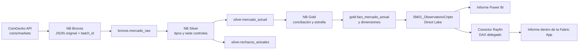
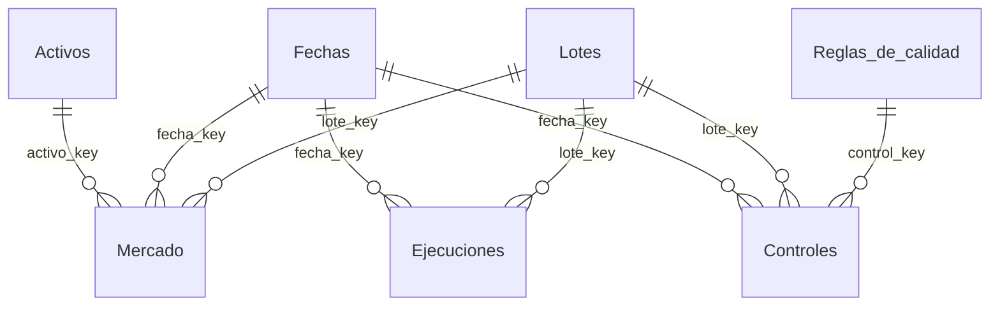

# Arquitectura del caso 01 · CoinGecko

La solución está en la carpeta `01-Criptomonedas` del [workspace Data Days](https://app.fabric.microsoft.com/groups/0245bb51-e0d1-40f1-b071-fcbbf1d7b155/list). La [Fabric App](https://early-tower-5ef68d90a6-spaincentral.webapp.fabricapps.net) presenta el caso y su informe; el [informe Power BI](https://app.fabric.microsoft.com/groups/0245bb51-e0d1-40f1-b071-fcbbf1d7b155/reports/eddcc051-24e7-47ed-b95b-10408e2c7890) ofrece la vista analítica completa.

## Movimiento del dato

| Tramo | Entrada | Salida | Comprobación |
| --- | --- | --- | --- |
| Fuente → Bronze | Respuesta REST en USD, top 100 por capitalización | JSON íntegro, manifiesto y `bronze.mercado_raw` | Identificador de lote y ruta del original |
| Bronze → Silver | Activos sin tipar | Foto actual y rechazos | Recibidos = aceptados + rechazados; bloqueos críticos |
| Silver → Gold | Foto validada | Hechos de mercado, ejecución, controles y dimensiones | Integridad y capitalización conciliada |
| Gold → análisis | Tablas Delta `gold` | Modelo Direct Lake y dos interfaces de informe | Refresco y consulta DAX sobre el lote publicado |

La canalización `DD01_PL_CoinGecko` ejecuta las tres etapas en serie. El primer intento creó Gold pero el refresco del modelo llegó antes de que el SQL endpoint viera las tablas; después de sincronizar metadatos, la segunda ejecución completó Bronze, Silver y Gold. La consulta de comprobación devolvió **100 activos y 100 filas de mercado**. Esto describe una fotografía, no un histórico de cotizaciones.

## Modelo de análisis

Las ocho relaciones del modelo son activas y filtran en una dirección. `Trazabilidad` queda desconectada porque documenta criterios, no hechos de mercado. El portafolio y el informe consultan el modelo publicado `SM01_ObservatorioCripto`; el código original y las definiciones adaptadas están en [`case-source/`](../case-source/) y [`fabric/`](../fabric/).

## Informe dentro de la Fabric App

El conector Rayfin de este caso consulta el modelo con la identidad delegada del usuario. Rayfin publicó su puente UserDataFunction en la misma carpeta de Fabric; el código de la app y el alias del conector están en este repositorio.

La pestaña **Informe** consulta `SM01_ObservatorioCripto` con Rayfin y permisos delegados. Las consultas DAX están en [`packages/frontend/src/queries/report/`](../packages/frontend/src/queries/report/). El panel presenta activos observados, concentración top 10, filas aceptadas y rechazadas; compara la capitalización y la variación de 24 horas de los diez líderes. Usa el lote actual para evitar mezclar fotografías.

**Comprobación del 22-11-2026:** el DAX devolvió 100 activos, 100 filas aceptadas, 0 rechazadas y una concentración top 10 del 90,89 %. Los datos mostrados por la app se vuelven a consultar al abrirla o pulsar «Actualizar».
